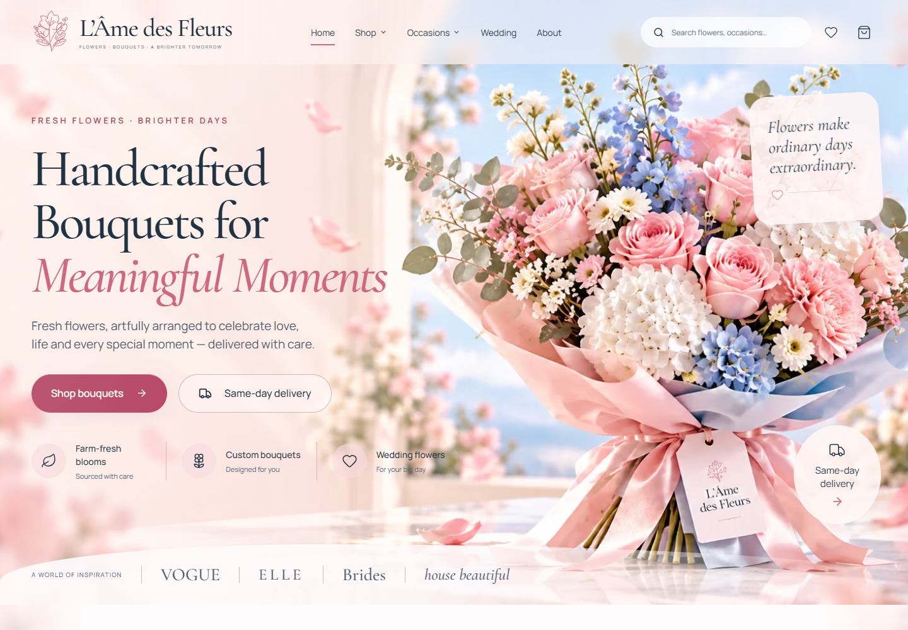
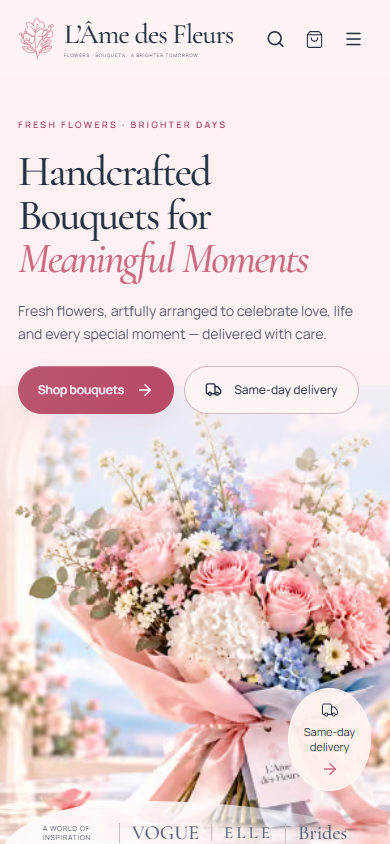
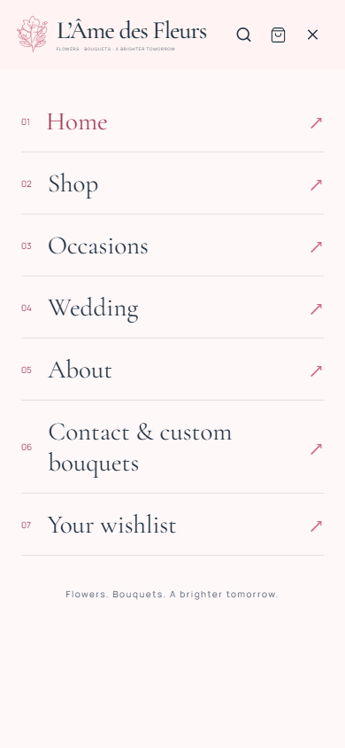
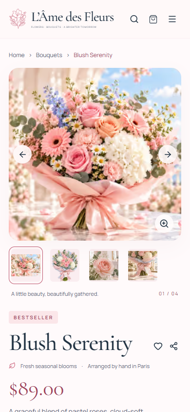
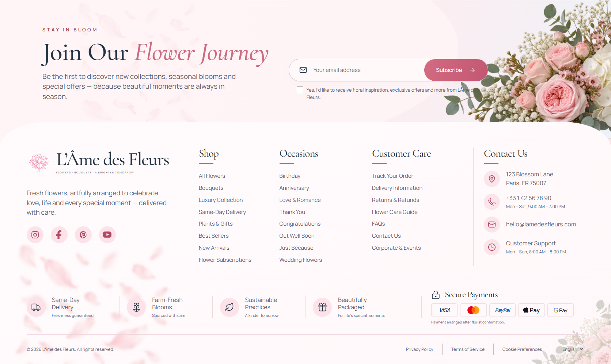

# L’Âme des Fleurs

Complete, responsive florist storefront built from the supplied floral designs using Next.js, React and TypeScript. All seven designed page families are implemented, alongside cart, wishlist, checkout, subscriptions and customer-care pages.

## Preview

Actual screenshots of the running website. Click any image to see it at full size.

[](docs/screenshots/home-desktop.png)

### On mobile

| Homepage                                                                                 | Navigation                                                                                                  | Bouquet details                                                                                                   |
| ---------------------------------------------------------------------------------------- | ----------------------------------------------------------------------------------------------------------- | ----------------------------------------------------------------------------------------------------------------- |
| [](docs/screenshots/home-mobile.png) | [](docs/screenshots/navigation-mobile.png) | [](docs/screenshots/bouquet-mobile.png) |

More views: [desktop catalogue](docs/screenshots/shop-desktop.png), [desktop bouquet details](docs/screenshots/bouquet-desktop.png), [mobile catalogue](docs/screenshots/shop-mobile.png).

### Newsletter and footer

[](docs/screenshots/footer-desktop.png)

[View the mobile footer](docs/screenshots/footer-mobile.png).

To refresh these screenshots, start the production site with `npm run build` and `npm start`, then run `npm run screenshots` in another terminal. Captures use Microsoft Edge; set `BROWSER_CHANNEL` to use another installed Playwright browser channel. Set `TEST_BASE_URL` if the site runs on another port.

## Stack

- Next.js 16.4
- React 19.3
- TypeScript
- Lucide React icons
- Self-hosted Cormorant Garamond and Manrope fonts
- CSS design tokens, responsive layouts, subtle motion and reduced-motion support
- Optimized WebP images and Next.js image delivery
- Playwright browser and API tests

## Run locally

```bash
npm install
npm run dev
```

Then open `http://localhost:3000`.

## What works

Search and combined catalogue filters, sorting, grid/list views, product galleries and zoom, bouquet sizes, gift messages, saved bouquets, persistent shopping bags, quantity controls, inquiry forms, newsletter submissions and order requests.

Original images in the parent directory and everything in the source `assets` folder remain untouched. All 45 supplied images are copied into this project's `assets` folder with descriptive names and categories. The site serves 51 complete standalone images from matching folders in `public/images`; sheets and moodboards are reference-only. All twelve bouquets have distinct primary photos and their own galleries. Four new bouquet portraits and eight botanical close-ups accompany the two earlier standalone details. A separately generated transparent floral photograph decorates the newsletter. The catalogue is editable in `src/lib/catalog.ts`, with galleries and botanical composition in `src/lib/product-photography.ts`.

The shared footer follows `Images  (4).png`, including its curved newsletter, floral crest, social icons, contact details and service/payment strip. Social icons currently use dummy platform URLs; set the optional public profile URLs in `.env.example` to replace them. Every product thumbnail updates the main photograph and zoom dialog, with previous/next controls, keyboard navigation and loading/retry feedback.

Run `npm run assets:prepare` to regenerate the optimized images from the internal library. The app builds and runs without the parent assets folder. See [docs/IMAGE_ASSETS.md](docs/IMAGE_ASSETS.md) for the image organization and generation prompts.

## Build and verify

```bash
npm run lint
npm run typecheck
npm run build
npm start
```

With a server running, use `npm test` for the browser/API suite, or `npm run test:mobile` for the mobile checks. Tests use the locally installed Microsoft Edge browser. On another machine, change the browser channel in `playwright.config.ts` or install Playwright Chromium. For tests, start the server with `SUBMISSIONS_DIR` pointing to `.test-data` so sample requests remain separate.

Mobile checks cover all 14 page types at 320, 360, 390, 430 and 768px, plus 844 × 390px landscape. They exercise navigation and search, rotation, filters and sorting, touch galleries, wishlist, persistent bag, checkout, subscription inquiries, FAQs and newsletter forms. Automated accessibility checks include the open mobile menu. These are browser emulation checks; physical iOS and Android device testing remains a separate release check.

## Forms and checkout

Forms save real submissions privately in `.data`, or deliver them to a configured HTTPS webhook. Copy `.env.example` to `.env.local` to configure the public origin and a durable submission destination.

Checkout currently creates an **order request**. It does not charge a card or guarantee delivery. Payment processing, live inventory, courier booking and automatic email/newsletter delivery require connected services. The interface clearly explains this before submission.

Verify the boutique details, product prices, customer-story content and policy pages before commercial launch. See [docs/IMPLEMENTATION.md](docs/IMPLEMENTATION.md) for routes, architecture, integration details and validation notes.
